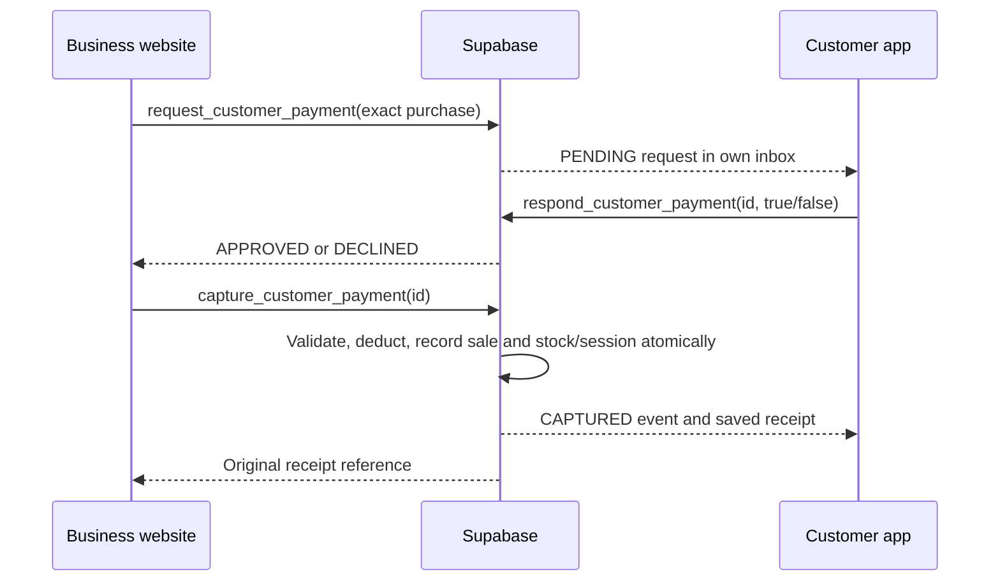

# Customer payment approval: app and platform admin handoff

Status: implemented in this business-web checkout and tested in isolated PostgreSQL. **Not applied to the hosted database or deployed to the website.** The customer application and platform admin website are separate projects and their UI has not been changed here.

Migration: `supabase/migrations/20261015133258_customer_payment_approval.sql`. Apply after the existing migrations through `20261013000014_align_staff_profile_roles.sql`. The migration changes existing payment permissions; deploy it together with the compatible business website and customer app. It does not migrate, merge or reset balances.

The hosted BuzzTap schema and existing function permissions were inspected read-only on 15 October 2026. Use a staging clone to verify REST responses, current triggers and simultaneous-device behavior before production rollout.

## Behavior to build



Approval alone does not deduct or reserve points. Only a successful capture charges the wallet. The business must complete the approved payment before handing over products or starting the workstation. The app must say **“Approved — waiting for the business to complete payment”** until it sees `CAPTURED`.

Both shared BP (`BUZZPOINTS`) and business-only CBP (`CUSTOMIZED`) require approval. Cash uses its existing checkout; it has no wallet approval step. There is no cashier PIN override, offline approval, administrator approval on the customer's behalf, automatic repeat charge, split payment or recurring mandate in this implementation.

NFC/card code and account selection identify a customer only. A typed or scanned card code must never be treated as payment approval.

## Identity and existing database locations

All the following tables are in the `public` schema. A customer uses their own Supabase Auth access token and the normal public/publishable API key. Never ship a service-role key in the app or either website.

| Location | Meaning and use |
| --- | --- |
| `auth.users.id` → `public.profiles.id` | Global authenticated user/customer UUID. The approving user must equal the payment request's `profile_id`. Customer profile must have `role='CUSTOMER'`, `status='ACTIVE'`. |
| `public.customers.id` | Business registration ID, **text in the hosted database**. This is not the customer's Auth UUID. |
| `public.customers.business_id`, `profile_id` | Map the business registration to the global account. Payment requests snapshot this mapping; capture rejects changed or inactive registrations. |
| `public.customers.customer_code`, `name`, `email`, `status` | Business customer display and registration fields. Do not use email or card code as an approval credential. |
| `public.customer_bp_wallets.customer_id`, `balance`, `updated_at` | Authoritative shared BP balance. Here `customer_id` is the **global profile UUID**, not `customers.id`. New RLS permits the customer to read their own row. |
| `public.business_bp_wallets.business_id`, `balance`, `updated_at` | Shared business BP balance, credited by BP purchases. |
| `public.business_customized_bp_wallets.business_id`, `profile_id`, `balance`, `updated_at` | CBP balance, primary key `(business_id,profile_id)`. Customer reads their own rows. Owners/managers read their business's rows. Cashiers/staff no longer receive the balance list. A negative balance recovers rebates already spent before a refund. |
| `public.business_customized_bp_ledger.id`, `business_id`, `profile_id`, `transaction_id`, `kind`, `amount`, `promotion_id`, `original_transaction_id`, `created_at` | Customer's own CBP history. `kind` is `EARN`, `REDEEM`, `REVERSAL`, `REFUND`. Read using the customer's token, filtered by their `profile_id`. |
| `public.business_transactions.id`, `business_id`, `customer_id`, `type`, `amount`, `status`, `metadata`, `created_by`, `created_at` | Merchant sale/refund receipt. Capture adds `metadata.payment_request_id`, `customer_approved_at`, `consent_version`. Customer app uses the immutable request snapshot below for its receipt; this table's existing RLS primarily serves business members. |
| `public.transactions.id`, `customer_id`, `business_id`, `amount_bp`, `transaction_type`, `metadata` | Existing shared BP transaction history. Shared transfer metadata identifies `wallet_source='customer_bp_wallets'`, `transfer_id`, `local_transaction_id`. Do not count these and the business receipt as two charges. |
| `public.business_customer_bp_transfers` | Private transfer proof, before/after balances and verified refunds. No browser/client table access. Business users must not obtain customer before/after balances from it. |
| `public.products_services.id`, `business_id`, `price`, `stock`, `status`, `item_type` | This website's catalog. Product payment requests require an active `PRODUCT`. Price is calculated by the database. |
| `public.workstations.id`, `business_id`, `rate`, `status`; `public.workstation_sessions.id`, `transaction_id`, `amount_paid`, `duration_seconds`, `ends_at` | Workstation price, captured session and saved deadline. The approved hourly rate determines purchased seconds. |

`customers.wallet_balance`, `wallet_ledger` opening balances, and `buzzpoint_wallets.balance_bp` are **not** the source for this shared BP checkout. Do not display them as shared BP, synchronize them into the current wallet, or call the older `process_customer_purchase` API. That older purchase API is disabled for clients by this migration.

## New tables and columns

### `public.customer_payment_requests`

Clients have SELECT access subject to RLS, and **no direct INSERT/UPDATE/DELETE**. Only checked RPCs change state. Rows are visible to their customer, active members of their business, and active platform admins. A different customer's UUID or a different business must return no rows.

| Columns | Type / purpose |
| --- | --- |
| `id` | UUID primary key; merchant-generated request/idempotency ID. Reuse on a network retry. |
| `business_id` | UUID, FK `businesses.id`. |
| `customer_id` | Text, business registration ID, logically points to `customers.id`. |
| `profile_id` | UUID, FK `profiles.id`; global account that must approve. |
| `created_by` | UUID, FK `auth.users.id`; staff member requesting the payment. |
| `kind` | Text: `PRODUCT` or `WORKSTATION`. |
| `payment_method` | Text: `BUZZPOINTS` or `CUSTOMIZED`. |
| `amount` | Positive bigint, at most 9,007,199,254,740,991; exact total in the selected points unit. |
| `business_name`, `item_name` | Text, server snapshots for the approval screen and receipt. |
| `product_id`, `quantity`, `unit_price` | Nullable text/integer/numeric; set for product requests. |
| `workstation_id`, `hourly_rate`, `duration_seconds` | Nullable text/numeric/bigint; set for workstation requests. Display the actual duration, including remaining seconds where applicable. |
| `input_payload` | JSONB, original request parameters used to reject changed retries. Treat as backend evidence, not editable UI state. |
| `state` | `PENDING`, `APPROVED`, `DECLINED`, `CANCELLED`, `CAPTURED`. |
| `consent_version` | Text, currently `payment-v1`; version of the payment confirmation wording. This is not blanket privacy consent or acceptance of every future charge. |
| `created_at`, `expires_at` | Timestamptz; expiry is five minutes from creation, **not five minutes from approval**. |
| `approved_at`, `approved_by` | Nullable timestamptz / Auth UUID. Populated on approval. |
| `captured_at`, `transaction_id`, `session_id` | Nullable timestamptz / merchant receipt UUID / session UUID. Populated by capture. |

`EXPIRED` is a **derived display state**, not a stored state: when `state IN ('PENDING','APPROVED') AND expires_at <= server time`, disable approval/capture and show Expired. The server enforces expiry independently of the phone's clock. Historical captured payments remain `CAPTURED`; a `REFUNDED` event records their refund.

Creation does not reserve stock, workstation availability or wallet funds. If a product price/name or station rate/name changes, request fresh approval. Account freeze, insufficient funds, unavailable stock/station, and a platform payment pause can also prevent capture. No new deduction or partial stock/session change survives a failed capture.

### `public.customer_payment_events`

Append-only evidence and the durable app notification/history source. Clients have SELECT only. The customer and business see events for their requests; dispute events are restricted to the customer, business owner/manager and platform admin.

| Columns | Meaning |
| --- | --- |
| `id uuid` | Event primary key. Use as notification deduplication key. |
| `request_id uuid` | FK `customer_payment_requests.id`. |
| `event_type text` | `PENDING`, `APPROVED`, `DECLINED`, `CANCELLED`, `CAPTURED`, `REFUNDED`, `DISPUTE_OPEN`, `DISPUTE_UNDER_REVIEW`, `DISPUTE_RESOLVED`, `DISPUTE_REJECTED`. |
| `actor_id uuid` | Auth user responsible; nullable for system activity. |
| `details jsonb` | Refund: `transaction_id`, `amount`. Dispute: `dispute_id`, customer-visible `resolution`. Other events currently `{}`. |
| `created_at timestamptz` | Server event timestamp. |

Successful full refunds from the existing BP/CBP refund RPCs append `REFUNDED` atomically. Repeating a verified refund does not issue another refund or event. A request remains `CAPTURED` after refund so the original approval evidence stays intact. Fetch events to determine refunded status.

### `public.customer_payment_disputes`

Customer/owner/manager/admin can read relevant rows. Cashiers and staff cannot read dispute text. Changes use RPCs only.

| Columns | Meaning |
| --- | --- |
| `id uuid`, `request_id uuid unique` | Dispute ID and FK to the completed payment; one report per request. |
| `profile_id uuid`, `business_id uuid` | Customer and business copied by the server. |
| `reason text` | Customer explanation, 10–2,000 trimmed characters. |
| `state text` | `OPEN`, `UNDER_REVIEW`, `RESOLVED`, `REJECTED`. |
| `resolution text` | Nullable customer-visible explanation, max 2,000 characters. Required by admin review RPC. |
| `created_at`, `updated_at`, `resolved_at` | Timestamptz; `resolved_at` nullable until closed. |
| `reviewed_by uuid` | Nullable reviewing admin Auth UUID. |

Opening/reviewing a dispute does not move funds. A closed dispute cannot be silently rewritten. Existing historical purchases without a payment request need the existing support process; this feature reports newly captured approved payments.

### `public.business_payment_controls`

`business_id uuid` primary key/FK; `points_payments_enabled boolean`; `reason text` (5–1,000 trimmed characters); `updated_by uuid`; `updated_at timestamptz`.

No row means points payments are enabled. A disabled business cannot create or capture new BP/CBP payments. Cash, refunds and old captured receipts remain available. The pause does not unapprove existing requests; if re-enabled within their expiry, they can still be captured. Cancel specific requests when investigating suspicious approvals.

### `public.business_payment_control_events`

Admin-only append-only pause/resume history: `id uuid`, `business_id uuid`, `points_payments_enabled boolean`, `reason text`, `actor_id uuid`, `created_at timestamptz`.

Privileged implementations live in the **non-exposed** `payment_private` schema. Keep that schema out of Supabase Data API exposed schemas. Public RPC wrappers invoke those functions; each implementation checks its own caller permissions.

## Customer application implementation

1. Add **Payment requests** to the signed-in customer app. Load own active requests on foreground/resume and every 3–5 seconds while viewing the screen; provide manual refresh and paginated history. Handle expired, cancelled, declined and already captured requests.
2. Show the saved business name, item/station, quantity or purchased time, exact amount, **shared BP versus CBP at this business**, and expiry before presenting Approve and Decline. Show the customer's own appropriate wallet balance on their device if helpful. Never combine CBP from different businesses.
3. On Approve, call the approval RPC with the customer's existing authenticated session. Disable double taps, and refetch the saved row after timeouts. A local biometric prompt can protect access to the app, but this backend does not verify a biometric signature, payment PIN, OTP or MFA step-up. Do not claim those protections unless separately implemented and enforced by the backend. Never ask the customer to tell their password/PIN/OTP to staff.
4. Keep the status screen open until capture, cancellation or expiry. Approval means waiting; capture means paid. Notify the customer on capture/refund and let them reopen their saved receipt.
5. Add **Report a problem** to captured payment details and show the dispute state and customer-visible review outcome. Let a customer report a charge even if they have subsequently been frozen; do not require staff permission to report it.

JavaScript examples (translate to the app's SDK as needed). For composite-returning RPCs use `.single()` to request one JSON object; ordinary table queries return arrays.

```js
const userId = (await supabase.auth.getUser()).data.user.id;

// RLS enforces ownership even if a client changes this filter.
const inbox = await supabase.from('customer_payment_requests')
  .select('*').eq('profile_id', userId)
  .in('state', ['PENDING', 'APPROVED'])
  .order('created_at', { ascending: false }).range(0, 49);

// Fetch the latest row before display/after any ambiguous network response.
const current = await supabase.from('customer_payment_requests')
  .select('*').eq('id', requestId).single();

const approved = await supabase.rpc('respond_customer_payment', {
  p_request_id: requestId, p_approve: true,
}).single();
// Decline: same call with p_approve: false.

// Customer may revoke an approved but not yet captured request.
const cancelled = await supabase.rpc('cancel_customer_payment', {
  p_request_id: requestId,
}).single();

// Receipt uses the immutable saved request, not current catalog prices/names.
// CAPTURED + transaction_id = completed sale; APPROVED is not a receipt.
const events = await supabase.from('customer_payment_events')
  .select('*').eq('request_id', requestId)
  .order('created_at', { ascending: true });

const report = await supabase.rpc('open_customer_payment_dispute', {
  p_request_id: requestId, p_reason: 'I do not recognize this purchase.',
}).single();

const reports = await supabase.from('customer_payment_disputes')
  .select('*').eq('profile_id', userId).order('created_at', { ascending: false });

const shared = await supabase.from('customer_bp_wallets')
  .select('balance,updated_at').eq('customer_id', userId).maybeSingle();
const customized = await supabase.from('business_customized_bp_wallets')
  .select('business_id,balance,updated_at').eq('profile_id', userId);
```

Handle SDK `error` on every call. A missing wallet row may display zero; a permission/network failure must display unavailable, not a false zero. Declining or cancelling is final for that request. Approval retries return the same approval while valid. Captured-payment retries return the original receipt even after expiry. Never generate another merchant request merely because a capture response was lost.

No Realtime publication changes or push providers are included. Foreground polling works without them. For optional Realtime, explicitly add the request/event tables to the publication after load testing; retain RLS, filter by the customer, and refetch on reconnect. A notification must open/refetch the payment, never approve it automatically.

### Optional push delivery backend still needed

The inspected database has `business_notifications` and workstation `devices`, but no customer push-token registry. Do not reuse workstation `devices` for customer phones. If push is required, the app developer must add the following in a separate migration and integrate the chosen provider (FCM/APNs/etc.):

| Proposed table (not created by this change) | Required columns / security |
| --- | --- |
| `public.customer_push_devices` | `id uuid PK`, `profile_id uuid FK profiles`, `provider text`, `token text unique`, `platform text`, `created_at timestamptz`, `last_seen_at timestamptz`, `revoked_at timestamptz nullable`. Token registration/removal must bind ownership to the verified Auth user server-side; enforce RLS and do not expose tokens to merchants or other customers. |
| Private `payment_private.push_deliveries` | `event_id uuid FK customer_payment_events`, `device_id uuid`, `state text`, `attempts integer`, `next_attempt_at timestamptz`, `sent_at timestamptz nullable`, `last_error text nullable`, unique `(event_id,device_id)`. Only the worker may write. |

Use committed payment events as an outbox, a trusted worker/Edge Function with server-held provider credentials, retry with deduplication, revoke invalid tokens, and send minimal lock-screen text. Derive the recipient from the request's `profile_id`, never from a caller-provided push destination. Push is an alert; the saved inbox and receipt remain authoritative. Marking notifications read across devices also needs a per-customer read cursor or receipt table; local read state is sufficient only for a first device-specific inbox.

## Business website changes included here

- Checkout and session forms create requests for BP/CBP. Cash retains immediate checkout.
- Product Purchase and Workstations list active approvals, poll every three seconds, support loading more requests, cancellation, and explicit completion. The five most recent completed payments offer saved receipts for recovery after an interrupted response/printout. Workstation capture remains restricted to owners/managers; product capture permits owner/manager/cashier/staff.
- Shared balances are removed from checkout selectors and customer lists, and from `get_business_shared_bp`. It returns business balance and customer profile eligibility only. The frontend also omits the legacy `customers.wallet_balance` field from its queries.
- Business-only CBP balances remain available to owners/managers for managing their own reward program; cashiers/staff do not receive that balance list.
- Saved business receipts include the approval reference/time and direct customers to report problems in the app.
- Owners/managers see reported payments in Transactions. They can investigate and use the existing verified refund action. Platform support records the dispute outcome.
- Browser writes to financial receipts, transfer proofs and wallet/ledger tables are revoked. Older directly callable point-purchase/session functions are revoked; existing public checkout functions now accept cash only.
- Anonymous execution of the legacy wallet-provisioning functions is revoked; signed-in integrations retain access subject to their existing ownership/admin checks.

Merchant request API, already called by this website:

```js
await supabase.rpc('request_customer_payment', {
  p_business_id: businessId,
  p_customer_id: businessCustomerId, // customers.id, NOT Auth UUID
  p_kind: 'PRODUCT',               // or WORKSTATION
  p_payment_method: 'BUZZPOINTS',   // or CUSTOMIZED
  p_product_id: productId,         // null for WORKSTATION
  p_quantity: quantity,            // null for WORKSTATION
  p_workstation_id: null,          // station ID for WORKSTATION
  p_amount: null,                  // whole points for WORKSTATION; database prices products
  p_request_id: stableRequestUuid,
}).single();
await supabase.rpc('capture_customer_payment', { p_request_id: requestId }).single();
```

At most five live requests per customer/business, plus thirty created requests per operator/minute, are allowed. These are database limits, not merely disabled UI buttons. Expired requests do not count toward the live-request limit. Production gateway abuse monitoring can supplement these limits.

## Platform BuzzTap admin website: features to add

This repository contains the business website, not the platform admin UI. The migration provides its data/API contract; the admin developer must add these screens. Use a normal signed-in admin session with `profiles.role='ADMIN'` and `status='ACTIVE'`; do not embed a service-role key.

Also audit existing admin funding/void/refund screens before rollout: this migration removes direct browser INSERT/UPDATE/DELETE/TRUNCATE permissions on financial receipts and wallets for the `authenticated` role, including admin logins. Such screens must already use the checked admin RPCs (for example `admin_load_customer_bp`, `admin_review_purchase_request`, `admin_void_transaction`) and their original validation. Calling those existing privileged functions still works under their own admin checks. Do not restore broad table write grants to repair an admin form.

| Admin feature | Read / action |
| --- | --- |
| Payment approval explorer | Read `customer_payment_requests`, paginate by date/business/customer/state; inspect exact snapshot, requester, approver and receipt/session IDs. Derive expiry. No “approve for customer” button. |
| Payment evidence timeline | Read `customer_payment_events` for a request, including capture/refund/dispute events. Existing `business_transactions`/`transactions` access follows their RLS; use the request and linked IDs to locate records in the existing admin transaction tools. |
| Dispute queue | Read `customer_payment_disputes`; filter `OPEN`/`UNDER_REVIEW`, business, date and age. Display report, approval evidence and verified refund reference. Set a support owner and response-time policy operationally; this schema does not include assignment/SLA fields. |
| Review outcome | Call `admin_review_payment_dispute(p_dispute_id uuid, p_state text, p_resolution text)`. Allowed new states: `UNDER_REVIEW`, `RESOLVED`, `REJECTED`. Require a 10–2,000 character customer-visible explanation. Returns the updated dispute. Closing a dispute **does not refund or adjust balances**. |
| Pause/resume points payments | Call `admin_set_business_points_payments(p_business_id uuid, p_enabled boolean, p_reason text)`. Reason 5–1,000 characters; returns `business_payment_controls`. Show the append-only `business_payment_control_events` history. This is not a customer account freeze and does not block refunds or cash. |
| Refund investigation | Business owner/manager/cashier currently uses `refund_shared_customer_bp(p_business_id,p_transaction_id)` or `refund_business_customized_bp(...)` on the original **business receipt UUID**. Admin review authority is separate from business membership; this change does not grant admins a blanket debit/refund override. If platform-initiated refunds are required, add a dedicated audited admin refund RPC that validates the original payment and uses the same wallet/ledger rules; do not write balances directly or use the legacy refund route. |
| Risk monitoring | Track repeated requests/declines, repeated failed captures, abnormal refund patterns and unresolved disputes. Persist operational security alerts separately; this change records successful state changes, not every denied API attempt. |

The hosted security advisor also reported existing anonymous-executable privileged functions, an unset search path on `set_updated_at`, and disabled leaked-password protection. These are existing findings, not proof that the new payment flow is exploitable. The migration closes the inspected legacy purchase bypass and relevant financial write grants. The platform owner should review the remaining existing Auth/function findings separately; this checkout does not claim a complete platform security audit.

## Privacy notice and payment wording

Suggested confirmation text for `payment-v1`: **“Approve [amount] [shared BP / CBP usable at business] for [items or workstation time] at [business]. The business can complete this charge until [expiry]. Approval does not reserve funds. You can cancel before the charge completes.”** The app must fill these values from the saved server request.

Update the actual customer terms and privacy notice before release to explain merchant/customer/platform roles, limited business access, payment approval, purchase and refund history, support access, dispute handling, retention purposes, and a contact for privacy requests. Explain CBP business restrictions and refund rebate reversals, including possible negative CBP balances. Explain purchased/shared BP and settlement terms separately; do not describe all BP as promotional rewards.

Have counsel confirm the operating jurisdiction, lawful bases, retention periods, consumer remedies and whether shared purchased BP/merchant settlement needs BSP or other authorization. No software change by itself certifies legal compliance. The earlier legal discussion assumed Philippine operations because the website uses pesos; the jurisdiction has not been confirmed.

## Rollout and acceptance

1. Apply the migration to a **staging clone**, not an empty project: this repository's migrations depend on the platform's existing tables/functions. Do not expose `payment_private` in the Data API.
2. Regenerate app/admin database types. Verify SDK composite RPC responses using `.single()`, customer RLS, and public-key + real customer/merchant/admin sessions through PostgREST.
3. Release the customer approval, receipt/history and problem-reporting screens and the business-web update together. Add the admin dispute queue and pause controls. If push is part of launch, finish the separate token/delivery worker integration too.
4. In staging, test two devices approving/cancelling/capturing the same request concurrently; two captures against one wallet; a pause or account freeze during capture; product price/stock and station availability changes; phone sleep/reconnect; expired/replayed approvals; a lost HTTP response after commit; full BP and CBP refunds and customer events. PGlite verifies PostgreSQL execution/permissions but serializes connections and does not test real lock contention or push delivery.
5. Inspect production grants/RLS, run Supabase advisors after migration, and confirm old point APIs fail closed even from a manually constructed request. Direct financial DML and TRUNCATE must be denied to anon/authenticated. Monitor capture errors after release.
6. If rollout fails, pause points payments and retain cash. Do not re-enable old direct debit APIs or rerun older migrations to work around missing app UI. Preserve captured payment/approval/refund evidence. A forward migration is safer than deleting the new tables after real payments exist.

Local validation commands:

```powershell
node supabase/tests/customer-payment-approval.cjs
node --test src/lib/*.test.js
npm run lint
npm run build
```

Reference documentation checked during implementation: [Supabase RLS](https://supabase.com/docs/guides/database/postgres/row-level-security), [database functions](https://supabase.com/docs/guides/database/functions), [PostgREST RPCs](https://docs.postgrest.org/en/latest/references/api/functions.html).
